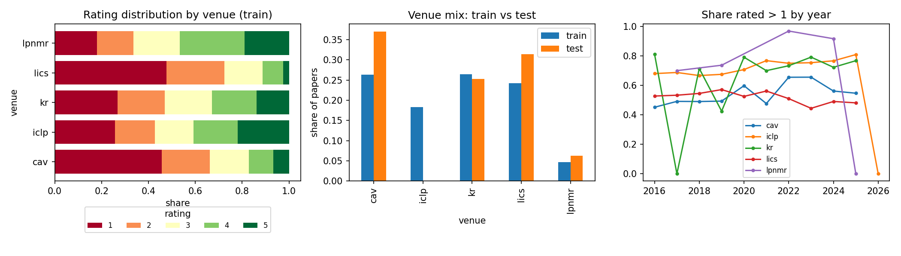
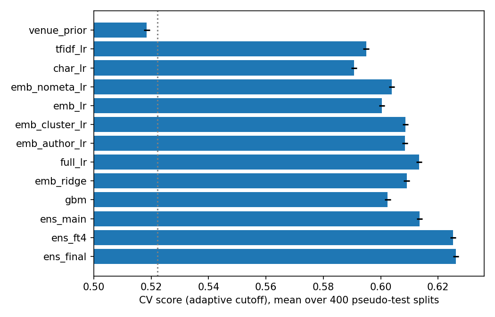
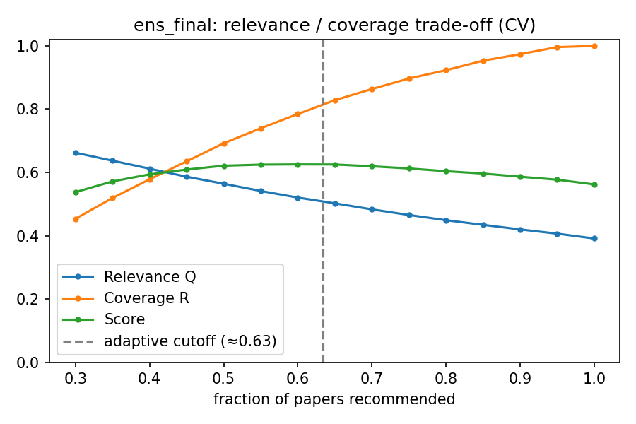
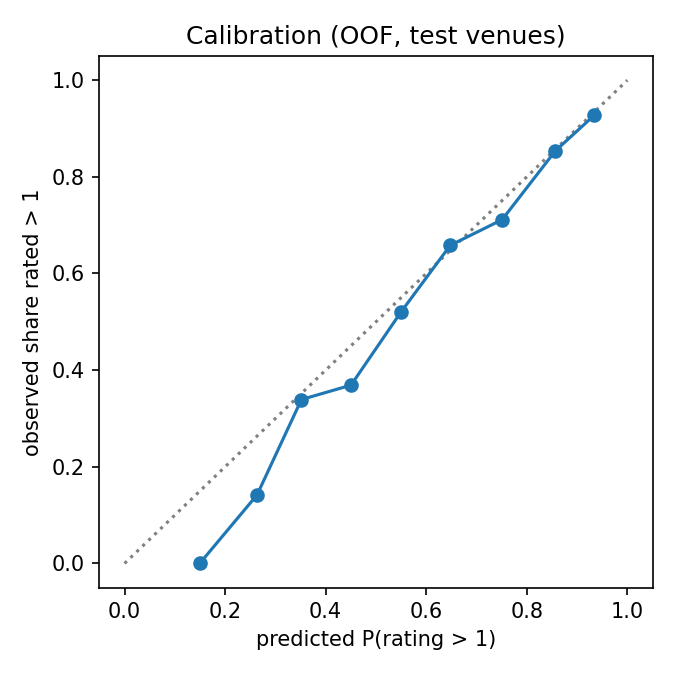

# Reading-Priority Recommendation for a Logic & Verification Researcher

| | |
| --- | --- |
| Kaggle team | _TODO_ |
| Members (name, student ID) | _TODO_ |
| GitHub repository | _TODO URL_ |
| Final commit | _TODO hash_ |
| Kaggle submission ID(s) | _TODO_ (file `submissions/final.csv`, MD5 `e4a83ebcb718cdf9696ec72c1aa35ab9`) |
| Public / Private score | _TODO_ / _TODO_ |

## 1. Problem formulation and domain understanding

**Stakeholder.** The ratings come from a single researcher, or a coherent group, working in logic in computer science. All papers come from five venues: CAV (computer-aided verification), LICS (logic in computer science), KR (knowledge representation), LPNMR and ICLP (logic programming and answer-set programming). A rating of 1 means "do not read". Ratings 2 to 5 mean increasing reading priority. The practical need is a triage tool. Faced with a new batch of conference papers, it should show the ones the researcher would want first and hide the ones they would skip, without hiding too many papers they would have valued.

**Inputs and outputs.** Each paper has only metadata: `title`, `venue`, `year`, `authors` and `doi`. There are no abstracts, full texts or citation counts. The output is one non-negative priority per test paper. Priority 0 means "do not recommend", and the evaluator reads the rest in descending priority, breaking ties by ID compared as text.

**Metric.** For each hidden 298-paper split, the score is the harmonic mean of:

- **Relevance** \(Q = \sum_r w_r g_r / \sum_r w_r\), with \(g_r=(y_r-1)/4\) and \(w_r = 1/\log_2(r+1)\). This is a position-weighted *average* gain of the recommended list. It is not normalised against an ideal ordering, so it punishes every rating-1 paper that is recommended, at any position.
- **Coverage** \(R\): the fraction of worthwhile papers (rating > 1) in the split that were recommended.

The two terms pull in opposite directions. Recommending everything gives \(R = 1\) but a low \(Q\). Recommending only the safest papers gives a high \(Q\) but a low \(R\). The score therefore rewards the triage behaviour the stakeholder wants. Because the harmonic mean is dominated by the weaker term, neither extreme pays off.

**Documentation inconsistency.** The overview mentions coverage "measured through title similarity", while the Evaluation section defines coverage as plain recall and states that title similarity is *not* part of the metric. We treat the formal Evaluation definition as authoritative. Topic diversity is therefore not optimised explicitly (Section 7).

## 2. Data analysis

Numbers come from `scripts/eda.py`, which writes `results/eda.json`, and the figure below.



**Labels.** The 2,494 training papers have the label counts 1: 903 (36%), 2: 514, 3: 438, 4: 367, 5: 272. The classes are imbalanced, and "do not read" is the largest one. 64% of training papers are worthwhile.

**Venue is the strongest metadata signal**, and its mix shifts between train and test:

| Venue | Train n | Mean rating | Share worthwhile | Test n |
| --- | --- | --- | --- | --- |
| cav | 657 | 2.12 | 0.54 | 221 |
| iclp | 456 | 2.94 | 0.74 | **0** |
| kr | 661 | 2.73 | 0.73 | 151 |
| lics | 604 | 1.94 | 0.52 | 187 |
| lpnmr | 116 | 3.14 | 0.82 | 37 |

The test set has no ICLP papers and has more CAV and LICS papers, which are the venues with the lowest ratings. Reweighting the training venue rates to the test mix gives an expected worthwhile share of **60%**, against 64% in train. The test set is therefore harder than a random training sample would suggest.

**Year.** Papers run from 2016 to 2025, plus one paper from 2026. Ratings rise slightly over time: 55% to 61% of papers are worthwhile in 2016 to 2019, against 67% to 70% in 2022 to 2025. The effect is small next to the venue effect.

**Authors.** 192 papers have no authors listed, and only 53% of them are worthwhile against 65% for the rest. Of 1,705 author mentions in the test set, 901 (53%) name an author who also appears in train.

**IDs.** Within every venue, ID correlates between -0.96 and -0.99 with year. IDs are assigned in blocks by venue and year, so ID adds nothing beyond venue and year, and it is deliberately **not** used as a feature.

**Duplicates and leakage checks.** No IDs or titles are shared between train and test. Within train, 16 rows form duplicate-title groups after normalisation. These are kept, but always placed in the same CV fold.

**Text.** Titles are short, at 8.4 words on average. Some contain HTML entities (`&amp;`) and accented characters. The test file is an RTF export of the CSV and needs a dedicated decoder (`src/data.py::decode_rtf_text`). After decoding it has exactly 596 rows, whose IDs match `Submission.csv`. Cleaning consists of HTML unescaping, NFC normalisation, whitespace collapsing and lower-casing the venue.

**What the metric rewards.** We simulated simple strategies on 298-paper training samples drawn with the test venue mix (`eda.json → metric_simulations`):

| Strategy | Score |
| --- | --- |
| Recommend everything, random order | 0.484 |
| Recommend everything, perfect order | 0.587 |
| Exclude exactly the rating-1 papers, random order | 0.694 |
| Exclude rating-1 papers and order perfectly | 0.757 (oracle ceiling) |

## 3. Insights

1. **Choosing which papers get priority 0 matters more than ordering them** (observation from the simulation). The position weights decay slowly: the 100th paper still has weight 0.15. \(Q\) is therefore close to the plain mean gain of the selected set. Perfect selection is worth +0.21 over random-all, while perfect ordering is worth only +0.10. *Implication:* the core model must estimate \(P(\text{rating} > 1)\) well, which is a **classification** problem. It also needs an explicit, well-founded rule for the cutoff.
2. **The preference is topical, not only venue-based** (observation). Metadata alone reaches only AUC 0.61 for "worthwhile versus not" on test-like venues. Inside each venue, the share of worthwhile papers varies strongly across KMeans topic clusters with at least 15 papers: 0% to 88% in CAV, 26% to 100% in KR and 21% to 74% in LICS. In the four test venues, every one of 54 "Proceedings of …" volumes is rated 1, while all 40 probabilistic or applied answer-set programming papers are worthwhile. *Implication:* title semantics must be the main representation. We expected pretrained scientific and general sentence encoders, and fine-tuned encoders, to beat bag-of-words. The ablation confirms this.
3. **Validation must copy the venue shift** (observation plus assumption). Because ICLP is absent from test and CAV and LICS are over-represented, a plain CV average would overstate both the score and the best fraction to recommend. *Assumption:* within each venue, test papers follow the same rating distribution as training papers. Nothing contradicts this, but it cannot be checked without labels. *Implication:* we score on pseudo test sets resampled to the test venue mix.
4. **Author identity is a weak signal** (observation). Only about half of the test author mentions are seen in train, and most authors have very few papers. *Testable expectation:* smoothed author target encoding should add little once titles are modelled. The ablation confirms this with a change of −0.0003.
5. **Calibrated probabilities make the cutoff transferable** (design reasoning). If \(P(\text{worthwhile})\) is calibrated, the expected \(Q\) and \(R\) of every prefix of the ranked list can be computed directly on the *test* papers. The cutoff then adapts to the actual test mix instead of reusing a fraction tuned on train.

## 4. Solution design and implementation

```
titles, venue, year, authors, DOI
  ├── metadata one-hot (venue, year, DOI type, #authors capped at 6, incl. 0)
  ├── title TF-IDF (word 1–2-grams, char 3–5-grams)
  ├── frozen title embeddings (BGE-base, SPECTER2, MPNet, MiniLM)
  ├── KMeans(k=30) topic clusters on BGE embeddings  ──► one-hot + smoothed cluster gain / worth rate
  └── fine-tuned encoders on "venue year: title"
          │
          ▼
  per model: p_worth = P(rating>1), e_gain = E[(rating−1)/4]
          │  (mean of members)
          ▼
  order by e_gain; keep the top k that maximises the plug-in expected score; others → priority 0
```

**Taught approaches, and how each one feeds the priorities.**

- **Classification.** `OrdinalLR` is a multinomial logistic regression over the five ratings. It yields \(p_\text{worth} = 1 - P(y=1)\) and \(e_\text{gain} = \sum_k P(y=k)\,g_k\). `BinaryRidge` uses a binary logistic regression for \(p_\text{worth}\). The fine-tuned encoders also have a five-class softmax head trained with cross-entropy. \(p_\text{worth}\) drives the coverage estimate, and therefore the cutoff.
- **Regression.** The ridge regression in `BinaryRidge` predicts the gain directly. Its output is averaged into \(e_\text{gain}\), which sets the reading order and the expected relevance.
- **Clustering.** KMeans with 30 clusters runs on L2-normalised BGE title embeddings (`TopicClusters`). Each paper gets its cluster one-hot vector plus the cluster's smoothed mean gain and worthwhile rate, with smoothing α = 10 and statistics computed from training-fold labels only. Adding clusters to the embedding model raises the CV score from 0.600 to 0.609, which is the largest single gain among the linear models. The clusters also drive the error analysis.

**Additional techniques, cited.**

- Frozen sentence encoders: BGE (Xiao et al., 2023), SPECTER2 (Singh et al., 2023), all-MPNet and all-MiniLM (Reimers & Gurevych, 2019).
- Fine-tuning of four encoders, BGE-base, E5-base, all-MPNet and SciBERT (Beltagy et al., 2019), with a classification head. Settings: input `"<venue> <year>: <title>"`, max 48 tokens, 3 epochs, learning rate 3e-5, AdamW with weight decay 0.01, 10% linear warm-up, batch size 32.
- The fine-tuned encoders give the largest gain overall (AUC 0.815 versus 0.783), presumably because they learn which *phrases* matter to this researcher instead of relying on generic similarity.

**Final model (`ens_final`).** This is an equal-weight mean of five members: the four fine-tuned encoders and `ens_main`, which is itself an equal-weight mean of six linear models (char-TF-IDF LR, TF-IDF LR, embedding LR, embedding + clusters LR, embedding + clusters BinaryRidge, TF-IDF BinaryRidge). The weights were not tuned. Equal weights avoid fitting noise from a single CV repeat, and nearby weightings scored within ±0.002.

**Priorities and cutoff (`src/cutoff.py`).** Test papers are ordered by \(e_\text{gain}\). For each prefix length \(k\), the plug-in estimates are:

\[
\hat Q_k = \frac{\sum_{r\le k} w_r\,\hat g_r}{\sum_{r\le k} w_r},\qquad
\hat R_k = \frac{\sum_{r\le k} \hat p_r}{\sum_{\text{all}} \hat p}
\]

The rule keeps the \(k\) that maximises \(2\hat Q_k\hat R_k/(\hat Q_k+\hat R_k)\). Selected papers receive priorities in (0, 10], proportional to their rank by \(e_\text{gain}\), so the ranks are unique and no ID tie-breaks are needed. All other papers receive 0. On the real test set, this rule recommends **381 of 596 papers (64%)**.

**Settings that were tried and dropped.**

- Gradient boosting (sklearn HistGradientBoosting) on cluster, author and kNN features scored 0.602.
- Author target encoding: no gain.
- Larger frozen encoders (BGE-large, E5-large, mxbai, GTE-large, Qwen3-0.6B): 0.596 to 0.606 each, no better than base models once combined.
- An inflated cutoff (×1.1 papers): −0.006.

## 5. Evaluation

### 5.1 Validation design

- **Folds.** We used 5-fold `StratifiedGroupKFold`, stratified by venue × label and grouped by normalised title, so duplicates never straddle folds. Every candidate uses the **same** seed-0 folds, so comparisons are paired. All supervised feature statistics, such as cluster gains and author encodings, are fit inside the training fold.
- **Test-like scoring.** From the out-of-fold predictions we draw 200 pseudo test sets of 596 papers each, with the real venue mix. We apply the full submission strategy, including the cutoff, to each whole set. We then split each set at random into two 298-paper halves and score both with the exact metric (`src/metric.py`, including the tie-break by ID as text). This mirrors how the real file is processed and evaluated.
- **Uncertainty.** The standard deviation across the 400 split scores is about 0.020. This is the expected Public-versus-Private noise for a fixed model. Because all methods share the same draws, *paired* differences are much less noisy. Even so, we treat gaps under about 0.005 as ties.
- **Leaderboard use.** The Public leaderboard was used only as a sanity check. No hyperparameter or cutoff was tuned on it, because 298 papers give a standard deviation of about 0.02, which is larger than most model differences.

### 5.2 Results and baseline comparison



| Model | AUC | Score (all) | Score (cutoff) | Q | R |
| --- | --- | --- | --- | --- | --- |
| Random order, recommend all (baseline) | – | 0.484 | – | – | 1.000 |
| Metadata only (`venue_prior`) | 0.612 | 0.522 | 0.519 | 0.365 | 0.897 |
| + word/char TF-IDF (`tfidf_lr`) | 0.745 | 0.556 | 0.595 | 0.471 | 0.810 |
| 4 frozen embeddings, no metadata | 0.774 | 0.559 | 0.604 | 0.480 | 0.815 |
| Metadata + 4 frozen embeddings (`emb_lr`) | 0.770 | 0.559 | 0.600 | 0.480 | 0.802 |
| + KMeans clusters (`emb_cluster_lr`) | 0.777 | 0.559 | 0.609 | 0.497 | 0.786 |
| + author target encoding | 0.778 | 0.560 | 0.608 | 0.498 | 0.784 |
| TF-IDF + embeddings + clusters (`full_lr`) | 0.781 | 0.561 | 0.613 | 0.503 | 0.788 |
| Gradient boosting | 0.757 | 0.556 | 0.602 | 0.503 | 0.752 |
| Linear ensemble (`ens_main`) | 0.783 | 0.562 | 0.614 | 0.487 | 0.830 |
| 4 fine-tuned encoders | 0.815 | 0.562 | 0.625 | 0.509 | 0.811 |
| **Final (`ens_final`)** | **0.815** | **0.563** | **0.626** | **0.510** | **0.812** |

The final model's 5th to 95th percentile range over splits is 0.595 to 0.659. Against the required baseline of recommending everything in random order, it gains +0.142. Of that gain, +0.079 comes from ordering alone, the "Score (all)" column, and +0.063 more comes from the cutoff. Against the oracle ceiling of 0.757, it closes 52% of the gap between baseline and ceiling.

### 5.3 Relevance–coverage trade-off and cutoff robustness



As the fraction of papers kept grows from 30% to 100%, \(Q\) falls steadily from 0.66 to 0.39 and \(R\) rises from 0.45 to 1. The score stays within 0.005 of its maximum (0.625) between 50% and 65% of papers kept. The adaptive cutoff lands at 63%, beside the best fixed fraction of 60%, and the two score the same (0.626). We prefer the adaptive rule for the submission because it re-estimates the cutoff from the *test* predictions. If the test set turns out to be easier or harder than expected, the rule moves the cutoff automatically, while a fixed fraction tuned on train would not. A fixed fraction is a reasonable fallback, given how flat the curve is.

The probabilities are well calibrated on test-like venues, which is what the plug-in rule needs:



### 5.4 Error analysis

Out-of-fold predictions from `ens_final` on the test venues (`results/error_analysis.json`, `results/errors_*.csv`):

- **By venue.** The AUC for "worthwhile" is 0.913 on lpnmr, 0.806 on cav, 0.800 on kr and **0.757 on lics**. LICS is both the weakest venue and the second largest in test. Its titles are abstract ("Curry and Howard Meet Borel", "Reasonable Space for the λ-Calculus, Logarithmically"), and their surface vocabulary says little about whether this researcher cares about them.
- **By rating.** The mean predicted \(p_\text{worth}\) rises monotonically, through 0.49, 0.64, 0.73, 0.83 and 0.89 for ratings 1 to 5. The ordering signal is therefore sound. The main failure is overlap between rating-1 and rating-2 papers, which is exactly where the cutoff has to decide.
- **Rating-1 papers ranked highly.** These are mostly titles that look like the researcher's favourite topics: tools and synthesis in CAV (*PAYNT*, *Trainify*), and explainable-ML or complexity papers in KR (*Explaining Decisions in ML Models: A Parameterized Complexity Analysis*, *Context-Based Belief Revision*). Titles alone cannot separate "right topic but not interesting to me" from "right topic and interesting".
- **Highly rated papers that were excluded.** These are theoretical LICS papers and atypical KR items, such as a rating-5 workshop-proceedings title. That item contradicts the otherwise reliable rule that proceedings volumes are skipped.
- **By cluster** (test venues only). The easiest clusters are near-pure: "Proceedings of …" volumes (54 of 54 rated 1, 15 in test) and probabilistic or applied ASP (40 of 40 worthwhile, 17 in test). The hardest cluster is fixpoint theory and bilattices (AUC 0.58, 27 in test), where ratings are close to a coin flip at 48% worthwhile.

### 5.5 Leakage, sampling bias and variability

- **Leakage.** Target statistics are computed out-of-fold, and duplicate titles share a fold. ID is excluded as a feature. KMeans and the frozen embeddings see test titles without labels. This is disclosed, and it is consistent between CV and submission. The fine-tuned encoders see only training labels.
- **Sampling bias.** Venue reweighting removes the known shift. Possible within-venue drift, such as new topics in 2024 and 2025, cannot be measured and remains a risk.
- **Variability.** The split-to-split standard deviation is 0.020, so Public and Private scores may differ by a few hundredths purely through sampling. Fine-tuning on Apple MPS is not bit-for-bit deterministic, which is why the exact submitted file is preserved. Fine-tuned models were evaluated on a single CV repeat because each takes about 5 minutes per repeat. The ranking of the model families held across all strategies, but small gaps (< 0.005) should not be read as real.

## 6. Conclusions

- The evidence supports a two-part view of the task. The score depends mostly on *who is excluded* (classification and the cutoff) and only secondarily on *order* (expected-gain regression). An explicit cutoff that maximises the expected score raises the score by about 0.06 at no extra modelling cost.
- The researcher's preference is mostly topical within each venue. Title semantics, and especially fine-tuned encoders, are the main signal. KMeans topic clusters turn this preference into readable groups ("skip proceedings volumes", "always read probabilistic ASP") and improve the linear models.
- The final system scores 0.626 in test-like CV, against 0.484 for the baseline and 0.757 for the oracle ceiling. Its probabilities are well calibrated, and its cutoff is robust over a wide range.

**Limitations.** Only titles and metadata are available, so the remaining errors (relevant-looking titles the researcher rated 1, and the abstract LICS papers) probably need abstracts or citation context. Within-venue drift is unchecked. The metric ignores topic diversity, so the system does not enforce it.

**What may generalise.** The approach should transfer to other triage tasks: classify, estimate the expected gain, then choose the cutoff by plug-in expected score. So should evaluating on resampled, test-like splits. The specific topic rules are particular to this researcher.

**Next steps.**

- Add abstracts through the DOI or Semantic Scholar.
- Repeat CV for the fine-tuned models with several seeds.
- Train per-venue calibration for LICS.
- Add a diversity-aware reordering, if the title-similarity reading of the overview turns out to be intended.

## 7. Team and contributions

| Member | Student ID | Contribution |
| --- | --- | --- |
| _TODO_ | _TODO_ | _TODO_ |

## References

- Beltagy, I., Lo, K., Cohan, A. (2019). *SciBERT: A Pretrained Language Model for Scientific Text.* EMNLP.
- Reimers, N., Gurevych, I. (2019). *Sentence-BERT: Sentence Embeddings using Siamese BERT-Networks.* EMNLP.
- Singh, A., D'Arcy, M., Cohan, A., Downey, D., Feldman, S. (2023). *SciRepEval: A Multi-Format Benchmark for Scientific Document Representations.* EMNLP (SPECTER2).
- Wang, L. et al. (2022). *Text Embeddings by Weakly-Supervised Contrastive Pre-training.* arXiv:2212.03533 (E5).
- Xiao, S., Liu, Z., Zhang, P., Muennighoff, N. (2023). *C-Pack: Packaged Resources to Advance General Chinese Embedding.* arXiv:2309.07597 (BGE).
- Pedregosa, F. et al. (2011). *Scikit-learn: Machine Learning in Python.* JMLR.
